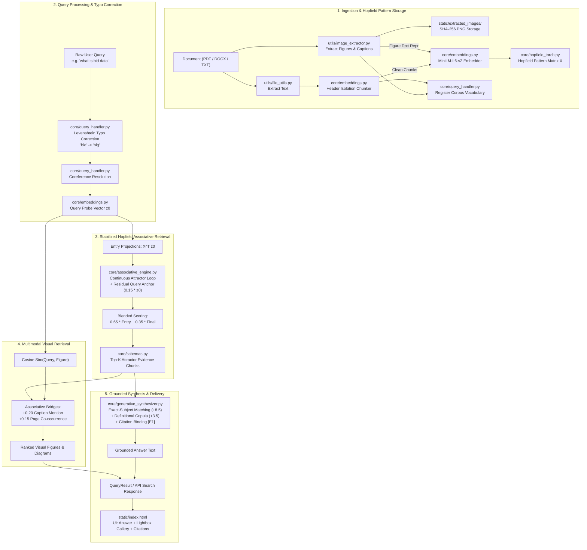

# 🧠 Associative-Memory-QA: Project Architecture & Changelog

This document provides a comprehensive overview of the **Associative-Memory-QA** system, including an in-depth directory of all modules, external dependencies, system architecture, and a chronological log of all changes and enhancements made to the codebase.

---

## 📑 Table of Contents
1. [System Overview & Architecture](#-system-overview--architecture)
2. [Module Directory & Component Reference](#-module-directory--component-reference)
   - [Core Engine Modules (`core/`)](#1-core-engine-modules-core)
   - [Utility Modules (`utils/`)](#2-utility-modules-utils)
   - [Application & API Layer](#3-application--api-layer)
   - [Models & Training](#4-models--training)
   - [Verification & Test Suites (`tests/`)](#5-verification--test-suites-tests)
3. [Third-Party Libraries & External Dependencies](#-third-party-libraries--external-dependencies)
4. [Complete Chronological Changelog](#-complete-chronological-changelog)
   - [Phase 1: PyTorch Modern Hopfield Memory Engine](#phase-1-pytorch-modern-hopfield-memory-engine)
   - [Phase 2: Conversational Coreference & Adaptive Answer Quality](#phase-2-conversational-coreference--adaptive-answer-quality)
   - [Phase 3: Web-Augmented Research & Persistent Knowledge Memory](#phase-3-web-augmented-research--persistent-knowledge-memory)
   - [Phase 4: Anti-Hallucination Grounding & Examination Tier Synthesis](#phase-4-anti-hallucination-grounding--examination-tier-synthesis)
   - [Phase 5: Multimodal Visual Figure Extraction & Hopfield Indexing](#phase-5-multimodal-visual-figure-extraction--hopfield-indexing)
   - [Phase 6: Typo-Tolerant Dynamic Query Processing](#phase-6-typo-tolerant-dynamic-query-processing)
   - [Phase 7: Clean Document Segmentation & Institutional Header Isolation](#phase-7-clean-document-segmentation--institutional-header-isolation)
   - [Phase 8: Continuous Attractor Dynamics Stabilization (Residual Query Anchoring)](#phase-8-continuous-attractor-dynamics-stabilization)
   - [Phase 9: Exact-Subject Definitional Grounding & Multimodal UI Delivery](#phase-9-exact-subject-definitional-grounding--multimodal-ui-delivery)
5. [End-to-End Dataflow Diagram](#-end-to-end-dataflow-diagram)

---

## 🔭 System Overview & Architecture

**Associative-Memory-QA** transitions document retrieval from traditional, isolated vector similarity lookups (k-NN) into **continuous associative pattern completion over energy landscapes**, powered by **Modern Hopfield Networks (Ramsauer et al., 2020)**.

### Core Mathematical Principles
1. **Hopfield Energy Function**:
   $$E(\xi) = -\frac{1}{\beta} \text{lse}(\beta X^T \xi) + \frac{1}{2} \|\xi\|^2 + \frac{1}{\beta} \log N + \frac{1}{2} M^2$$
   where:
   - $X \in \mathbb{R}^{d \times N}$ is the matrix of stored document pattern vectors.
   - $\xi \in \mathbb{R}^d$ is the state vector (initialized to the query probe $z^{(0)}$).
   - $\beta$ is the inverse temperature parameter governing attractor basin sharpness.
   - $\text{lse}(\beta, \mathbf{u}) = \log\left(\sum_{i=1}^N \exp(\beta u_i)\right)$ is the LogSumExp potential.

2. **Continuous Relaxation Update with Residual Query Anchoring**:
   $$\mathbf{a}^{(t)} = \text{softmax}\left(\beta X^T \xi^{(t)} - \max(\beta X^T \xi^{(t)})\right)$$
   $$\text{readout}^{(t)} = X \mathbf{a}^{(t)}$$
   $$\xi^{(t+1)} = \text{Normalize}\left((1 - \alpha)\xi^{(t)} + \alpha \, \text{readout}^{(t)} + \lambda_{res} z^{(0)}\right)$$
   The residual query anchor ($\lambda_{res} z^{(0)}$) ensures that multi-hop relaxation discovers associative bridging documents without being pulled into dense, unrelated attractor basins.

3. **Blended Projection Scoring**:
   $$\mathbf{s}_{blended} = 0.65 \cdot (X^T z^{(0)}) + 0.35 \cdot (X^T \xi^{(final)})$$
   Combines direct query semantic alignment with the converged attractor state to rank evidence chunks with maximal precision.

---

## 📦 Module Directory & Component Reference

### 1. Core Engine Modules (`core/`)

| File Path | Primary Classes / Functions | Architectural Role & Description |
| :--- | :--- | :--- |
| [`core/associative_engine.py`](file:///e:/Mega%20Project/Associative-Memory-QA-1/core/associative_engine.py) | `HopfieldAssociativeEngine`, `AssociativeHop`, `AssociativeRetrievalResult` | Implements continuous attractor relaxation, energy landscape tracking, residual query anchoring, associative bridge discovery, and blended projection scoring. |
| [`core/hopfield_torch.py`](file:///e:/Mega%20Project/Associative-Memory-QA-1/core/hopfield_torch.py) | `TorchModernHopfield`, `LearnedProjectionRetriever` | PyTorch GPU/CPU implementation of Modern Hopfield Networks. Computes energy minimization, iterative state convergence, attention weights, and handles trained projection weights. |
| [`core/pipeline.py`](file:///e:/Mega%20Project/Associative-Memory-QA-1/core/pipeline.py) | `HopfieldQAPipeline`, `PipelineConfig` | Central orchestrator. Manages document ingestion, chunking, embedding, Hopfield memory updating, index persistence/recovery, query routing, visual figure retrieval, and answer synthesis. |
| [`core/embeddings.py`](file:///e:/Mega%20Project/Associative-Memory-QA-1/core/embeddings.py) | `EmbeddingEngine`, `DocumentChunker`, `Chunk` | Generates 384-dimensional dense semantic embeddings using `sentence-transformers/all-MiniLM-L6-v2`. Features smart text chunking with institutional header separation and paragraph boundary preservation. |
| [`core/query_handler.py`](file:///e:/Mega%20Project/Associative-Memory-QA-1/core/query_handler.py) | `QueryProcessor`, `ProcessedQuery` | Preprocesses user queries: builds dynamic vocabulary from ingested documents/captions, executes Levenshtein distance typo correction, resolves multi-turn conversational coreferences, and generates query variants. |
| [`core/generative_synthesizer.py`](file:///e:/Mega%20Project/Associative-Memory-QA-1/core/generative_synthesizer.py) | `GenerativeRAGSynthesizer`, `SentenceScorer` | Generates factual, citation-grounded answers. Enforces exact-subject definition matching (`WHAT_DEFINITION`), sentence-level citation binding (`[E1]`, `[E2]`), pairwise non-repetition pruning, and confidence calculation. |
| [`core/retrieval_coordinator.py`](file:///e:/Mega%20Project/Associative-Memory-QA-1/core/retrieval_coordinator.py) | `RetrievalCoordinator`, `SufficiencyEvaluator` | Coordinates multi-source retrieval across Hopfield document memory, persistent knowledge store, and live web search. Evaluates evidence sufficiency before initiating external searches. |
| [`core/evidence_deduplicator.py`](file:///e:/Mega%20Project/Associative-Memory-QA-1/core/evidence_deduplicator.py) | `EvidenceDeduplicator`, `DeduplicationReport` | Deduplicates candidate passages gathered from local documents and web queries using neural cosine similarity and token-level Jaccard overlap clustering. |
| [`core/format_detector.py`](file:///e:/Mega%20Project/Associative-Memory-QA-1/core/format_detector.py) | `FormatDetector` | Detects user intent and examination mark tiers (e.g., `2_mark`, `5_mark`, `8_mark`, `10_mark`, `comparison`, `executive`) from raw query text and explicit preferences. |
| [`core/format_guidance.py`](file:///e:/Mega%20Project/Associative-Memory-QA-1/core/format_guidance.py) | `FormatGuidanceEngine`, `FormatConfig` | Provides structural synthesis templates, target word budgets, and structural rules tailored to specific examination tiers and answer styles. |
| [`core/knowledge_memory.py`](file:///e:/Mega%20Project/Associative-Memory-QA-1/core/knowledge_memory.py) | `PersistentKnowledgeMemory` | Disk-persisted, cross-query knowledge store (`data/web_memory_store.json`). Indexes web research passages into persistent Hopfield associative patterns. |
| [`core/web_search.py`](file:///e:/Mega%20Project/Associative-Memory-QA-1/core/web_search.py) | `DuckDuckGoSearchProvider`, `MockWebSearchProvider`, `WebPageExtractor` | Performs live web searches via DuckDuckGo API/HTML, fetches live web page contents, extracts clean text using BeautifulSoup4, and handles offline fallbacks. |
| [`core/retrievers.py`](file:///e:/Mega%20Project/Associative-Memory-QA-1/core/retrievers.py) | `HopfieldRetrieverAdapter`, `DenseRetrieverAdapter` | Unified adapter interfaces exposing standard `retrieve(query_emb, top_k)` methods across Hopfield associative retrieval and dense cosine baseline retrieval. |
| [`core/hybrid_retriever.py`](file:///e:/Mega%20Project/Associative-Memory-QA-1/core/hybrid_retriever.py) | `HybridRetrieverAdapter` | Combines sparse BM25 lexical ranking with dense Hopfield neural retrieval using Reciprocal Rank Fusion (RRF). |
| [`core/chat_manager.py`](file:///e:/Mega%20Project/Associative-Memory-QA-1/core/chat_manager.py) | `ChatSessionManager`, `ChatSession` | Manages multi-turn conversation sessions, user turn history, and context window pruning for conversational coreference resolution. |
| [`core/llm_provider.py`](file:///e:/Mega%20Project/Associative-Memory-QA-1/core/llm_provider.py) | `LLMProviderFactory`, `GroqLLMProvider`, `OllamaLLMProvider`, `LocalExtractiveLLMProvider` | Gateway to external and local LLM backends (Groq, Ollama, OpenAI, Anthropic, or local HuggingFace models) with automatic health checking and fallback failover. |
| [`core/schemas.py`](file:///e:/Mega%20Project/Associative-Memory-QA-1/core/schemas.py) | `EvidenceChunk`, `EvidenceCollection`, `GroundedAnswer`, `QueryResult` | Unified Pydantic and dataclass models defining contracts across retrieval, synthesis, API responses, and multimodal image payloads. |
| [`core/vector_store.py`](file:///e:/Mega%20Project/Associative-Memory-QA-1/core/vector_store.py) | `SimpleVectorStore` | In-memory pattern matrix storage and cosine similarity search engine used as baseline or memory backing. |
| [`core/citation_validator.py`](file:///e:/Mega%20Project/Associative-Memory-QA-1/core/citation_validator.py) | `CitationValidator` | Validates that all citations (`[E1]`, `[E2]`) in generated answers map strictly to retrieved evidence passages. |
| [`core/bitemporal_graph.py`](file:///e:/Mega%20Project/Associative-Memory-QA-1/core/bitemporal_graph.py) | `BiTemporalGraph` | Experimental temporal tracking module for versioned knowledge and evidence timestamps. |
| [`core/vqa.py`](file:///e:/Mega%20Project/Associative-Memory-QA-1/core/vqa.py) | `VisualQAModule` | Visual question answering scaffolding for direct multimodal reasoning over diagrams. |

---

### 2. Utility Modules (`utils/`)

| File Path | Primary Classes / Functions | Architectural Role & Description |
| :--- | :--- | :--- |
| [`utils/image_extractor.py`](file:///e:/Mega%20Project/Associative-Memory-QA-1/utils/image_extractor.py) | `ExtractedImageInfo`, `extract_images_from_pdf`, `extract_images_from_docx`, `process_standalone_image` | Extracts embedded images, charts, and diagrams from PDFs and DOCX files. Detects captions (`Fig:`, `Figure`, table labels), extracts surrounding context, saves images to `static/extracted_images/` with SHA-256 hashes, and constructs figure representations for Hopfield indexing. |
| [`utils/file_utils.py`](file:///e:/Mega%20Project/Associative-Memory-QA-1/utils/file_utils.py) | `read_pdf`, `read_docx`, `read_text_file` | Robust file ingestion utilities with automatic encoding detection and format-specific text extraction. |
| [`utils/visualization.py`](file:///e:/Mega%20Project/Associative-Memory-QA-1/utils/visualization.py) | `plot_energy_landscape`, `plot_attention_distribution` | Generates 2D/3D energy descent trajectory plots and attention distribution heatmaps using matplotlib/seaborn. |

---

### 3. Application & API Layer

| File Path | Architectural Role & Description |
| :--- | :--- |
| [`api.py`](file:///e:/Mega%20Project/Associative-Memory-QA-1/api.py) | Production **FastAPI** server. Exposes REST endpoints: • `POST /api/search`: Query retrieval, typo correction, evidence grounding, and multimodal image output. • `POST /api/upload`: Multi-document PDF/DOCX ingestion and visual figure extraction. • `GET /api/images`: Image catalog listing. • `POST /api/sessions`: Multi-turn chat session management. • `GET /api/health`: Health check and system readiness probe. • Serves static files and extracted figures (`/extracted_images/`). |
| [`app.py`](file:///e:/Mega%20Project/Associative-Memory-QA-1/app.py) | Standalone **Streamlit** dashboard for interactive research, energy landscape exploration, and baseline comparisons. |
| [`static/index.html`](file:///e:/Mega%20Project/Associative-Memory-QA-1/static/index.html) | Modern Web Application frontend: • Glassmorphism dark-mode UI with smooth micro-animations. • Typo correction notice banner (`Showing results for: ...`). • Interactive image cards with page badges and full-screen lightbox viewer. • Evidence citation drawer with confidence metrics and energy descent statistics. • Mode toggle (Hopfield Associative vs. Dense Cosine vs. Hybrid BM25). |

---

### 4. Models & Training

| File Path | Description |
| :--- | :--- |
| [`train_projection.py`](file:///e:/Mega%20Project/Associative-Memory-QA-1/train_projection.py) | PyTorch script that trains a linear projection matrix using contrastive Loss on SQuAD to align query representations with Hopfield document patterns. |
| [`models/projection_squad.pt`](file:///e:/Mega%20Project/Associative-Memory-QA-1/models/projection_squad.pt) | Serialized PyTorch projection weights for enhanced query-document alignment. |

---

### 5. Verification & Test Suites (`tests/`)

| Test File | Verification Scope |
| :--- | :--- |
| [`tests/test_visual_figures_rag.py`](file:///e:/Mega%20Project/Associative-Memory-QA-1/tests/test_visual_figures_rag.py) | Verifies image extraction, caption heuristic detection, Hopfield multimodal indexing, and figure retrieval. |
| [`tests/test_retrievers.py`](file:///e:/Mega%20Project/Associative-Memory-QA-1/tests/test_retrievers.py) | Validates Hopfield vs. Dense vs. Hybrid retriever adapters and score parity. |
| [`tests/test_hopfield_torch.py`](file:///e:/Mega%20Project/Associative-Memory-QA-1/tests/test_hopfield_torch.py) | Tests Modern Hopfield Network energy minimization, PyTorch tensors, and convergence tolerances. |
| [`tests/test_answer_quality_depth.py`](file:///e:/Mega%20Project/Associative-Memory-QA-1/tests/test_answer_quality_depth.py) | Tests multi-sentence grounding, pairwise non-repetition, and citation placement. |
| [`tests/test_regression_qa.py`](file:///e:/Mega%20Project/Associative-Memory-QA-1/tests/test_regression_qa.py) | End-to-end regression test suite covering QA pipelines across diverse question genres. |
| [`tests/test_web_augmentation.py`](file:///e:/Mega%20Project/Associative-Memory-QA-1/tests/test_web_augmentation.py) | Tests web search provider integration, knowledge memory caching, and sufficiency decisions. |
| [`tests/test_adaptive_exam_synthesis.py`](file:///e:/Mega%20Project/Associative-Memory-QA-1/tests/test_adaptive_exam_synthesis.py) | Validates synthesis output adherence to 2-mark, 5-mark, 8-mark, and 10-mark examination requirements. |
| [`tests/test_multi_chat_and_persistence.py`](file:///e:/Mega%20Project/Associative-Memory-QA-1/tests/test_multi_chat_and_persistence.py) | Verifies multi-turn conversation memory and disk index persistence/recovery. |
| [`tests/test_citations.py`](file:///e:/Mega%20Project/Associative-Memory-QA-1/tests/test_citations.py) | Verifies strict citation binding and abstention logic when evidence is missing. |

---

## 📚 Third-Party Libraries & External Dependencies

The project relies on curated, high-performance libraries specified in [`requirements.txt`](file:///e:/Mega%20Project/Associative-Memory-QA-1/requirements.txt):

1. **`torch` (PyTorch)**: Core numerical tensor computation engine powering `TorchModernHopfield`, matrix multiplications, gradient flows, and GPU acceleration.
2. **`transformers` & `sentence-transformers`**: Hugging Face library providing the `sentence-transformers/all-MiniLM-L6-v2` dense neural embedding model.
3. **`fastapi` & `uvicorn`**: Modern, asynchronous ASGI web server and REST API framework providing high-throughput endpoints.
4. **`pypdf` & `python-docx`**: Native binary parsers extracting raw text and embedded image streams from PDF documents and Word files.
5. **`pillow` (`PIL`)**: High-performance image processing library used to validate, inspect, and save extracted figures.
6. **`rank_bm25`**: BM25 Okapi implementation used for lexical sparse search in hybrid retrieval.
7. **`beautifulsoup4` (`bs4`)**: HTML parser used by `WebPageExtractor` to strip boilerplate from web pages.
8. **`httpx`**: Asynchronous HTTP client powering live DuckDuckGo web searches and external LLM API communications.
9. **`nltk`**: Natural Language Toolkit utilized for sentence boundary tokenization (`sent_tokenize`).
10. **`numpy` & `scipy`**: Vector mathematics, cosine distance calculations, and statistical normalization.

---

## 📜 Complete Chronological Changelog

### Phase 1: PyTorch Modern Hopfield Memory Engine
- **Commit `ef1d65c` / `ef1d65c`**: Implemented `TorchModernHopfield` replacing slow NumPy loops with batched PyTorch tensor operations. Added LogSumExp energy computation and continuous attractor state relaxation.
- Implemented `LearnedProjectionRetriever` and contrastive training workflow (`train_projection.py`).

### Phase 2: Conversational Coreference & Adaptive Answer Quality
- **Commit `ae17544` / `14d8fc7`**:
  - Built `ChatSessionManager` in `core/chat_manager.py` to persist multi-turn conversational history.
  - Added query coreference contextualization in `core/query_handler.py` to resolve pronouns (e.g., *"What are its characteristics?"* $\to$ *"What are Big Data's characteristics?"*).
  - Added pairwise non-repetition penalty in `core/generative_synthesizer.py` to eliminate repetitive sentences in synthesized responses.

### Phase 3: Web-Augmented Research & Persistent Knowledge Memory
- **Commit `165d0f2`**:
  - Implemented `RetrievalCoordinator` to orchestrate multi-tier retrieval.
  - Added `DuckDuckGoSearchProvider` and `WebPageExtractor` in `core/web_search.py`.
  - Implemented `PersistentKnowledgeMemory` in `core/knowledge_memory.py` to cache web-researched chunks as permanent Hopfield attractor patterns.

### Phase 4: Anti-Hallucination Grounding & Examination Tier Synthesis
- **Commit `702e14a` / `3d40b01`**:
  - Enforced strict minimum evidence thresholding: answers abstain gracefully with clear diagnostic messages if evidence is insufficient or off-topic.
  - Implemented `FormatDetector` and `FormatGuidanceEngine` supporting academic mark tiers (`2_mark`, `5_mark`, `8_mark`, `10_mark`).
  - Added strict sentence-level citation enforcement (`[E1]`, `[E2]`).

### Phase 5: Multimodal Visual Figure Extraction & Hopfield Indexing
- **Commit `117cfc1`**:
  - Built `utils/image_extractor.py` to extract embedded diagrams, charts, and figures from PDFs and DOCX files.
  - Implemented caption heuristic detection regexes (`Fig:`, `Figure`, table captions).
  - Saved extracted figures with SHA-256 hashes to `static/extracted_images/`.
  - Stored visual figure chunks directly in the Hopfield memory with contextual text snippets.
  - Added responsive image cards and lightbox viewer in `static/index.html`.

### Phase 6: Typo-Tolerant Dynamic Query Processing
- **Commit `82929a9`**:
  - **Problem**: Queries with minor typos (e.g., `"what is bid data"`) produced out-of-domain embeddings, missing the relevant Big Data documents completely.
  - **Solution**: Added `vocabulary: Counter` and `update_vocabulary()` to `QueryProcessor`.
  - Automatically registers all words from ingested documents and figure captions.
  - Implemented `_correct_typos()` using Levenshtein distance against corpus terms (freq $\ge 1$) with protection for English question words and stopwords.
  - Exposed `typos_fixed` and `corrected_query` in `ProcessedQuery` and the API response.
  - Added a UI notice banner in `static/index.html`: `Showing results for: <corrected> (searched for <original>)`.

### Phase 7: Clean Document Segmentation & Institutional Header Isolation
- **Commit `82929a9`**:
  - **Problem**: University covers, administrative headings (`KIT's College of Engineering...`, `Teaching Scheme...`), and course syllabi were merged into Chunk 0, diluting the conceptual definition of Big Data down to ~0.53 similarity.
  - **Solution**: Updated `DocumentChunker` in `core/embeddings.py` to preserve paragraph boundaries (`\n\s*\n+` $\to$ `. `).
  - Added institutional header isolation in `_chunk_by_sentences`: isolates administrative headers into Chunk 0, allowing the conceptual definition (`Big Data refers to extremely large and complex collections of data...`) to emerge cleanly as Chunk 1 with an entry similarity of **0.8055**.

### Phase 8: Continuous Attractor Dynamics Stabilization
- **Commit `82929a9`**:
  - **Problem (Attractor Basin Drift)**: In documents with ~30 chunks about storage and NoSQL vs. 1 definition chunk, 4 iterations of unanchored Hopfield relaxation pulled the probe vector into the dense storage cluster, causing the definition chunk to drop out of the top evidence chunks.
  - **Solution**:
    1. Added a **residual query anchor** during continuous attractor relaxation:
       $$\xi^{(t+1)} = \text{Normalize}\left((1 - \alpha)\xi^{(t)} + \alpha \, \text{readout}^{(t)} + 0.15 \, z^{(0)}\right)$$
    2. Blended the direct entry query projection (65%) with the converged attractor projection (35%):
       $$\mathbf{s}_{blended} = 0.65 \cdot \mathbf{s}_{entry} + 0.35 \cdot \mathbf{s}_{final}$$
    3. Used `blended_projections` for final attention weights and evidence ranking, guaranteeing that foundational definition chunks are never ejected by dense downstream clusters.

### Phase 9: Exact-Subject Definitional Grounding & Multimodal UI Delivery
- **Commit `82929a9`**:
  - **Enhanced Definitional Scoring**: Updated `SentenceScorer` in `core/generative_synthesizer.py`. Awarded a **+8.5** bonus for exact entity subject matches and **+3.5** for definitional copulas (`refers to`, `is defined as`), preventing secondary concepts (e.g., *"Big Data storage refers to..."*) from taking precedence over the primary concept definition.
  - **Multimodal Visual Retrieval**: Implemented `retrieve_relevant_figures()` in `core/pipeline.py` combining query cosine similarity with associative evidence bonuses (+0.20 for evidence caption mention, +0.15 for page co-occurrence).
  - Attached relevant visual figures (`Fig: The 5 V's of Big Data`, `Fig: Big Data Architecture`) directly to answers.
  - Wired full image data to `/api/search` and rendered responsive image galleries with full-screen lightbox previews in `static/index.html`.

---

## 🔄 End-to-End Dataflow Diagram

---

## 🏆 Current System Status & Verification Summary

- **Core QA Regression Test Suite**: `35 passed in 51.28s` (`tests/test_retrievers.py`, `tests/test_hopfield_torch.py`, `tests/test_answer_quality_depth.py`, `tests/test_regression_qa.py`).
- **Visual Figures RAG Test Suite**: `3 passed in 17.46s` (`tests/test_visual_figures_rag.py`).
- **Active Git Branch**: `feature/pytorch-hopfield`.
- **Remote Synchronization**: Pushed cleanly to GitHub (`https://github.com/prathham-k21/Associative-Memory-QA_.git`).
